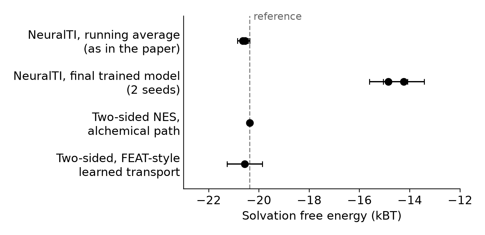

# NeuralTI solvation: reproduction and two-sided checks

Independent reproduction of the LJ-solute-in-LJ-solvent example of
[Solvation Free Energies from Neural Thermodynamic Integration](https://arxiv.org/abs/2410.15815)
(Máté, Fleuret and Bereau, JCP 162, 124107, 2025), built on the
[authors' code](https://github.com/balintmate/neuralTI-solvation) at commit `f756b30`.
We also compare it with two-sided nonequilibrium switching (NES + BAR) and a FEAT-style learned-transport estimator.

The companion repository for the dense LJ fluid paper (JPCL 2024) is
[neuralti-reproduction](https://github.com/William-Wei-hu/neuralti-reproduction).

## Main results

Reference: ΔF = −20.37 ± 0.01 kBT from two-sided NES + BAR along the alchemical path,
consistent with standard TI over 65 windows (−20.07 trapezoid, −20.21 Simpson).



- **NeuralTI matches the paper only as a running average over training.**
  - The released code trains with target score matching (TSM); its running estimate is −14.4.
  - With the denoising score matching (DSM) loss described in the paper and σ_mid = 0.01, two seeds give −20.6 and −20.5. The paper does not report σ_t; σ_mid = 0.005 and 0.02 give −17.6 and −41.7.
  - Evaluated with the final parameters held fixed, the same models give −14.9 and −14.2 (TSM: −2.5).
- **Why:**
  - The learned U_t agrees with the interpolant distribution only near t = 0.5. Elsewhere ⟨∂_tU⟩ on interpolant samples and under exp(−U_t) differ by tens of kBT, with errors of both signs that largely cancel.
  - The estimate also moves by several kBT with every parameter update.
- **Two-sided NES is exact on any path.**
  - Along the alchemical path it reaches ±0.013 kBT in about 1 GPU-hour.
  - Along the learned NeuralTI U_t (TSM) it still gives −20.31 ± 0.27, at higher dissipation.
- **FEAT-style learned transport is unbiased but costly.** With a learned velocity field and the TSM score, it gives −20.57 ± 0.70, but forward and reverse work barely overlap (≈ 20 kBT dissipation). At equal error it costs about 10³× more GPU time than NES along the alchemical path. Note that this is not FEAT as published: here the two fields were not trained jointly.

All numbers are in `results/data/`; single-model standard errors are bootstrap estimates.

## Methane in MACE-OFF water and a local radial map

- `mlip_methane/` runs the same two-sided switching for methane in 216 waters, with the machine-learned potential
  MACE-OFF23(S).
  - Switching runs stably, but forward and reverse work barely overlap even at 32 ps.
  - What lags is the radial position of the nearby water.
- `escort/` inserts a small learned radial map around the solute into every switching stage. On the LJ system it
  stays exact and lowers the wasted work by about one third at the same cost.

Details, run instructions and sources: [docs/solvation-mlip-and-local-map.md](docs/solvation-mlip-and-local-map.md).
The MACE-OFF weights (Academic Software Licence, non-commercial) are not included.

## Repository layout

| Path | Contents |
|---|---|
| `patches/dsm.patch` | Adds the DSM loss to the upstream code (U_t unchanged) |
| `scripts/get_upstream.sh` | Clones upstream at `f756b30` and applies the patch |
| `scripts/setup_run.sh` | Creates `runs/<model>/` with a bundled checkpoint |
| `models/` | Final checkpoints (upstream pickle format) and their resolved Hydra configs |
| `nes/` | LJ solvation system, NES with HMC/MALA kernels, endpoint sampling, BAR/Jarzynski/Crooks estimators |
| `diagnostics/` | U_t self-consistency (I(t) vs E(t)), fixed-parameter evaluation, exact training replay |
| `feat/` | Velocity-field training and the FEAT-style forward/backward work estimator |
| `mace/` | MACE energy network for the upstream training loop; two-head MACE (score and velocity) |
| `mlip_methane/` | Methane in MACE-OFF water: mace-jax interface with 4D decoupling, switching runs, lag analysis |
| `escort/` | Local radial map inserted into NES stages (LJ): map, runner, training and arms |
| `docs/` | Notes on the methane and local-map work |
| `tests/` | Estimator checks on toy systems with exact ΔF (CPU) |
| `results/` | Reduced data (CSV/JSON) and the figure script output |

## Usage

Python 3.11, JAX with CUDA for anything beyond the toy tests.

```bash
pip install -r requirements.txt
scripts/get_upstream.sh                     # upstream/neuralTI-solvation, patched
python tests/toy_tests.py                   # NES estimators on toy systems (CPU)
python tests/toy_tests_feat.py              # FEAT-style estimator on toy systems (CPU)
python scripts/plot_estimates.py            # figure from results/data
```

**Training (upstream loop).** Run from `upstream/neuralTI-solvation`:

```bash
./run_exp.sh model.loss_type=dsm model.sigma_mid=1e-2 'model.loss_x_weight=lambda t: 1.0' PRNGKey=0
```

For the MACE energy network, copy `mace/mace_solvation.py` and `mace/config_mace.yaml` into `experiments/` and add `--config-name config_mace`; this needs mace-jax (see `requirements.txt`).

**Diagnostics on a trained model:**

```bash
scripts/setup_run.sh egnn-dsm-smid0.01-seed0
python diagnostics/fine_grid.py --out outputs/fine --runs egnn-dsm-smid0.01-seed0       # fixed-parameter ∫I dt
python diagnostics/ut_consistency.py --out outputs/ut --runs egnn-dsm-smid0.01-seed0    # I(t) − E(t)
python diagnostics/nti_replay_dsm.py --run egnn-dsm-smid0.01-seed0 --out outputs/replay
```

**Two-sided NES:**

```bash
python nes/sample_endpoints.py --end 0 --out runs/endpoints      # and --end 1
python nes/run_nes.py --path base --direction fwd --kernel hmc --grad-budget 240000 \
    --endpoints runs/endpoints --out runs/base-hmc/fwd.npz       # and --direction rev
python nes/analyze_nes.py --runs runs/base-hmc --out outputs/base.json
```

**Environment variables:**
- `NTI_UPSTREAM`: patched upstream checkout. Default `upstream/neuralTI-solvation`.
- `NTI_RUNS`: training run directories. Default `runs/`.
- `NTI_NES_RUNS`: NES endpoint and baseline runs read by `escort/`. Default `runs/`.
- `MACE_OFF_BUNDLE_DIR`: converted MACE-OFF bundles for `mlip_methane/`. Default `bundles/`.

## Conventions

- Units are kBT (β = 1).
- The Hamiltonian is the upstream `target_systems.LJ3D_with_solute`: 512 solvent particles and one solute in a periodic box.
- ΔF is F(coupled) − F(decoupled).
- Models were trained for 50,000 steps on one A100. Endpoint data are regenerated by upstream MCMC and are not bundled.

## Attribution

Code and results here are an independent reproduction, not endorsed by the original authors. Upstream code is MIT-licensed (Copyright (c) 2025 Bálint Máté); see `LICENSE`. Please cite the original paper when using this repository.
