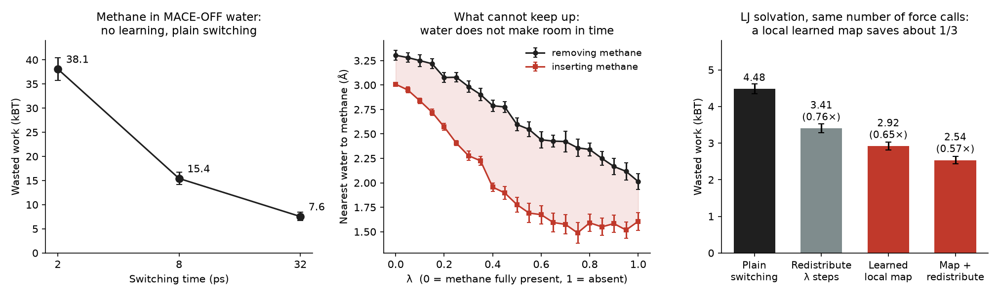

# Methane in MACE-OFF water, and a local radial map for LJ switching

This note covers two additions to the repository:

- `mlip_methane/`: two-sided nonequilibrium switching (NES) for methane in water, with the whole box described by the
  machine-learned potential MACE-OFF23(S). Nothing is learned here; it is the same forward/reverse switching + BAR that
  is used for the LJ system in the main README.
- `escort/`: a small learned map that moves the solvent near the solute radially at every switching stage, tested on
  the LJ system of the main README.

All numbers below come from single runs of a single system. Units are kBT.



`python scripts/plot_key_results.py` redraws this figure from the JSON files in `results/data/`.

## Systems and methods

**Methane in water (`mlip_methane/`).**

- System: CH4 + 216 H2O, 653 atoms, cubic box L = 18.67 Å (0.997 g/cm³), 298.15 K.
- Potential: MACE-OFF23(S), converted from mace-torch to mace-jax, float64 throughout.
- Decoupling: the 4D decoupling of Picha et al., JPCL 16 (2025), doi:[10.1021/acs.jpclett.5c02980](https://doi.org/10.1021/acs.jpclett.5c02980).
  Solute–solvent graph edges are stretched as r → r + λ (max(0, r_max − r) + ε), so λ = 0 is the coupled system and
  λ = 1 puts every solute–solvent edge beyond the MACE cutoff (fully decoupled).
- Switching: λ moves on a linear schedule. Each stage is an energy jump followed by one HMC step (fresh momenta,
  L = 40 leapfrog steps, dt = 0.5 fs, Metropolis test). That is 41 force calls and 20 fs per stage.
- Roots: 20 chains per end. The kernel and dt were chosen by fixed rules (`j1_endpoints.py`).
- Tiers: 2, 8 and 32 ps of switching (K = 100, 400 and 1600 stages).
  - Tiers A and B use 32 forward/reverse pairs each.
  - Tier C uses 14 pairs.

**Local radial map (`escort/`).**

- System: the LJ solute in 512 LJ solvent particles of the main README, on the alchemical (base) path. The reference
  is ΔF = −20.365 ± 0.013.
- The map: a monotone rational-quadratic spline g(r) in the solvent–solute distance r. Inside the cutoff, every solvent
  particle moves along its radial direction from r to g(r); particles outside the cutoff and the solute do not move.
  - Cutoff: 0.35 box ≈ 3.15σ.
  - 8 spline bins; g(0) = 0, g(r_c) = r_c and g'(r_c) = 1, so the map is continuous and C¹ at the cutoff r_c.
  - The inverse and the log-determinant are in closed form, so forward and reverse works are exact and BAR stays
    unbiased.
- Where it is used: at every NES stage, the map is applied before the HMC step. Its parameters come from a small MLP
  of the stage time, scaled by the stage width.
- Training uses pilot-chain samples only, never the estimation roots. Two losses were tried:
  - BD-HD: the Bhattacharyya distance, then the harmonic-overlap loss.
  - KL: stage-wise forward + reverse KL.
- Related work: Baron & Panagiotopoulos, "Accelerating Chemical Potential Calculations with Minimal Normalizing Flows"
  (arXiv 2606.25229), use a closely related minimal map with BD/HD training, applied over a few large λ windows. Here
  the same kind of map is inserted into every stage of a many-stage switching protocol.

## Main results

1. **A single trained NeuralTI network is not reliable** (LJ, main README).
   - Free energies from neighbouring checkpoints at the end of training scatter by about ±4 kBT (standard deviation
     4.3 and 4.1 for two seeds).
   - Only the average over many checkpoints matches the reference.
2. **Two-sided NES without learning is accurate and cheap on LJ.** It gives −20.365 ± 0.013 in about 1 GPU-hour and
   is the baseline for every comparison below (`results/data/references.csv`).
3. **Learned transport of the whole box (FEAT-style) costs about 10³× more GPU time at equal error.**
   - The estimate is unbiased (main README).
   - The free-energy change depends mostly on the ~20 solvent particles near the solute, but the network moves all
     512, and its errors add up over the whole box.
4. **Methane in MACE-OFF water: plain switching runs stably, but it is not cheaper than existing approaches.** The
   difficulty is local and radial.
   - Mean dissipation (W_F + W_R)/2 is 38.1 ± 2.4, 15.4 ± 1.3 and 7.6 ± 0.9 at 2, 8 and 32 ps (left panel).
   - Forward and reverse work only start to overlap at 32 ps: logistic overlap 3e−10, 0.010 and 0.14. No tier passed
     the overlap gate, so no free energy is reported.
   - Rough extrapolation from tier C: reaching 0.34–0.68 kBT would take about 1e7–3e7 force calls. This uses a
     dissipation-to-variance factor fitted on LJ, and a small-sample correction measured on the 14 tier-C pairs, so
     treat it as an order of magnitude only.
   - What lags is the distance between the water and the methane (middle panel). At the same λ, the nearest water is
     0.3–0.9 Å closer during insertion than during removal (|z| up to 12.6). Water orientation shows no loop. The
     hydrogen-bond loops appear only at λ ≥ 0.6, where almost no work is dissipated.
   - Redistributing the switching stages alone, with no map, lowers the dissipation by 13%. The tier-B setting has the
     same roots and keys, and the non-uniform λ grid has density ∝ √(per-bin dissipation of tier B). Dissipation goes
     from 15.43 to 13.44, a paired ratio of 0.871 ± 0.048.
5. **On LJ, the local learned map is exact and saves about one third of the wasted work at equal cost** (right panel;
   K = 114 stages, about 2.5e3 force calls per trajectory).

   | Arm | Mean dissipation | Ratio to plain switching | BAR ΔF |
   |---|---|---|---|
   | Plain switching | 4.480 ± 0.137 | 1 | −20.42 ± 0.16 |
   | Redistributed λ stages, no map | 3.405 ± 0.127 | 0.76 | −20.36 ± 0.14 |
   | Learned map (BD-HD) | 2.919 ± 0.109 | 0.65 | −20.38 ± 0.12 |
   | Learned map (KL) | 2.974 ± 0.109 | 0.66 | −20.34 ± 0.11 |
   | Learned map + redistributed stages | 2.535 ± 0.102 | 0.57 | −20.37 ± 0.12 |

   - Every arm agrees with the reference within 3 combined standard errors.
   - A mapped stage needs one extra energy call (2622 instead of 2508 calls per trajectory), and the GPU time per
     stage rises by about 2%.
   - With 10× more stages (K = 1143), the dissipation is 0.463 for plain switching, against 0.344 (BD-HD) and 0.273
     (KL) for the learned map.
   - Using very few stages and relying on the map to carry the transport does not pay. At equal cost, many small
     stages do much better than a few large ones (`lj_fewstep.py`, K = 5–40).

**Negative results.**

- On MACE-OFF methane, the radial map has not been trained successfully. With the LJ training recipe (stage-wise KL),
  the training signal is buried in the energy fluctuations. On held-out chains, the trained map was slightly worse than
  the identity (+0.71 kBT summed over 25 stages), and the switching run with the map was not carried out.
- Redistributing λ stages alone gives only part of the gain:
  - 3.41 against 4.48 on LJ (0.76×);
  - 13% on methane (0.87×).
- Moving the whole box with a learned field costs about 10³× more GPU time than plain NES at equal error.

**Not answered here.**

- How much a trained local map saves on MACE-OFF methane.
- Polar or charged solutes, where the water orientation may also lag.
- A many-body velocity field restricted to the solvation shell. Nothing seen for methane suggests that one is needed.

## How to run

**Environment.**

- Python 3.11, with JAX and CUDA on an 80 GB A100 for the methane runs.
- mace-jax at commit `e8a6f2d`; we used jax 0.10.2, flax 0.12.8 and cuequivariance-jax 0.10.0 for the default `cueq`
  backend.
- mace-torch 0.3.17 and torch, for the conversion only.
- The LJ scripts need the core `requirements.txt` plus optax.

**Weights.** Download `MACE-OFF23_small.model` from <https://github.com/ACEsuit/mace-off>.

- The MACE-OFF weights are distributed under the Academic Software Licence (academic, non-commercial use).
- Neither the weights nor the converted bundle are redistributed here.
- The sha256 values of our copy of the weights and of our converted bundle are listed at the end of this note.

```bash
python mlip_methane/convert_mace_off.py MACE-OFF23_small.model bundles/off23s   # CPU
export MACE_OFF_BUNDLE_DIR=bundles                                              # or MaceIface(..., bundle=DIR)
```

**Methane switching** (one A100 each; tier C took 1.6 GPU-hours):

```bash
python mlip_methane/j1_endpoints.py --out runs/methane/endpoints
python mlip_methane/j2_switch.py run A B --roots runs/methane/endpoints --out runs/methane/tiersAB
python mlip_methane/j3_switch.py run --roots runs/methane/endpoints --ref runs/methane/tiersAB --out runs/methane/tierC
python mlip_methane/lagB_switch.py run --roots runs/methane/endpoints --ref runs/methane/tiersAB --out runs/methane/lagB
python mlip_methane/hysteresis_analysis.py runs/methane/lagB --roots runs/methane/endpoints --out outputs/hysteresis-results.json
python mlip_methane/lag_analysis.py --roots runs/methane/endpoints --j2 runs/methane/tiersAB \
    --j3 runs/methane/tierC --out outputs/lag-results.json      # final-state lag, reported only
```

- The reported roots came from a run that reused the equilibration (S1) of an earlier attempt with `--resume-s1`. In
  that run, the wall-clock guard shortened the production segments to 2.28 ps.
- `lagB_switch.py` repeats tier B and also stores frames on a 21-point λ grid. Its self-check against the tier-B run
  gave "trajectories identical" (max |ΔW| 3.6e−9 kBT).

**LJ local map** (inputs from the `nes/` scripts of the main README):

```bash
python nes/sample_endpoints.py --end 0 --out runs/endpoints        # and --end 1
python nes/run_nes.py --path base --direction fwd --kernel hmc --M 1 --h 2e-6 --L 20 --grad-budget 2400 \
    --endpoints runs/endpoints --out runs/base-hmc-G2400-M1/fwd.npz  # and --direction rev
python nes/analyze_nes.py --runs runs/base-hmc-G2400-M1 --out outputs/base-G2400.json
NTI_NES_RUNS=runs python escort/lj_arms.py runs/escort-arms                         # ~0.7 GPU-h
NTI_NES_RUNS=runs python escort/lj_fewstep.py runs/escort-arms runs/escort-fewstep
```

- `lj_arms.py` trains the maps and runs the K = 114 and K = 1143 arms.
- `lj_fewstep.py` runs the few-stage scan and the map + redistributed-stages arm.

**Files.**

| File | Role |
|---|---|
| `mlip_methane/mace_iface.py` | MACE-OFF energy and forces with 4D decoupling, edge-overflow check, system builder |
| `mlip_methane/convert_mace_off.py` | Torch → mace-jax conversion (not rerun in this standalone form) |
| `mlip_methane/mlip_nes.py` | NES stage, HMC/GHMC kernels, keys, probes |
| `mlip_methane/j1_endpoints.py` | Endpoint roots, dt scan and kernel choice |
| `mlip_methane/j2_switch.py` | Tiers A, B (2, 8 ps) and their gates |
| `mlip_methane/j3_switch.py` | Tier C (32 ps) and the three-tier analysis |
| `mlip_methane/lagB_switch.py` | Tier B again, with frames on a λ grid |
| `mlip_methane/hysteresis_analysis.py`, `lag_analysis.py` | Structural loops along λ; lag of the final states |
| `escort/escort_map.py` | Radial spline map, inverse, log-determinant, parameter nets |
| `escort/escort_nes.py`, `escort_nes_v3.py` | NES runner with the map inserted in each stage (v3 adds per-stage tables) |
| `escort/lj_arms.py`, `lj_fewstep.py` | LJ training, arms and analysis |

## Sources of the numbers

The copies in this repository have been cleaned: paths became arguments or environment variables, dry-run branches
and run-specific start guards were removed, and comments were edited. The algorithms and numerics are unchanged. The
numbers were produced by the original scripts (sha256 below); **none was rerun from the cleaned copies.**

| Result | Data file here | Producing script(s) | Source data |
|---|---|---|---|
| Methane dissipation, tiers A–C | `results/data/methane_switching.json` | `j2_switch.py` [s1] (A, B); `j3_switch.py` [s2] (C, analysis) | tier-C `analysis.json` [d1] |
| Nearest-water loop | `results/data/methane_hysteresis.json` | `lagB_switch.py` [s3]; `hysteresis_analysis.py` [s4] | `hysteresis-results.json` [d2] |
| LJ arms, K = 114 and 1143 | `results/data/lj_local_map_K114.json` | `lj_arms.py` [s5]; `escort_nes.py` [s6]; `escort_map.py` [s7] | arms `analysis.json` [d3] |
| LJ map + redistributed stages | `results/data/lj_local_map_K114.json` | `lj_fewstep.py` [s8]; `escort_nes_v3.py` [s9] | `map-dens-K114-M1-{fwd,rev}.npz` [d4, d5]; few-stage `analysis.json` [d6] |
| Methane, redistributed stages only (0.871 ± 0.048) | not included | arms script of the MACE-OFF map experiment [s10] (not in this release) | `analysis.json` [d7] |
| Methane map training (+0.71 kBT against the identity) | not included | same experiment (not in this release) | `train_history.json` [d8] |
| Checkpoint scatter, ±4 kBT (result 1) | not included | checkpoint-series evaluation (not in this release) | `analysis.json` [d9] |
| About 10³× GPU time (result 3) | `results/data/two_sided_estimates.csv` | main README | energy-call ledger [d10] |
| Figure | `results/figures/key_results.png` | `scripts/plot_key_results.py` (reads only the three JSON files above) | — |

sha256:

- [s1] `1c542f460572aa5996a712480600c1ad09fe5c8f9f0383c08602ffef307c3e8d`
- [s2] `a8254504e00c6b629a2ed2952108c3500629f95c5cf1a9c6ca9e0452cc04b1f5`
- [s3] `a687ffe44bfdf1373fc9816fda82a1eebeaa3fa26f6d5f364b7e77e0ae3eceed`
- [s4] `be8967799e491809d78099192bc2f8405f482be6442067e8cabd6845cde76256`
- [s5] `fb135eb0924fc3b07add478be27d5164abac4261c1a23470010eeded0c6f00d3`
- [s6] `c4a4b6f093ef93d82fad727bed27ce2776d78e0a21a8f45c5c11fc2b0de0db7b`
- [s7] `c6d6634ba1f22ee8147d7073a4cef2efa96961b5d3ad5fcf8e864adb80acc2f9`
- [s8] `648a4ead199c838c1747a85efba57ef7948ecb95b07f66386881faa92b747080`
- [s9] `352033e4ec675bc6ac58bf460fa26752ef00a8afba2062734e074807fb99636c`
- [s10] `e681d0ae0664e33489c2384d4d7c6801bdf898e6890c067d4e8032381a5f0774`
- [d1] `503d20d5e0c89119bb20c53017564fa3e3f73008f8a1c076984758ed0fa6e242`
- [d2] `342e5b8bd3a6e6cd858962f80fbe9e76c6a224b429bae34288b447152bb4cb4c`
- [d3] `a44019204c69cfe4b0256c32fd58b2bda7844eb1dc6085ea1bc49f2e9bb584c5`
- [d4] `8d56f7c2f2e1963c7084b2604426282d3fa344fac977a9b7cdb025be06639896`
- [d5] `3d558e4926f5b96aa3e897865cdf55f360ffd142b12ee96c91cfc363c9274342`
- [d6] `5711c0818c4a8efea11e59f6d7fcd875244f348e688d7058a05b884059d4bcac`
- [d7] `68082e225755a241e4a686d83a9f5b7b9f6c43f76009d8d4c5905341aab67881`
- [d8] `456fa4d4b9ac7ed5c4930d35f3a7d69d0d1ad53927c40e2ea5fc2b5b76819341`
- [d9] `7e6388ea59b1b49f828d138730187f5ddc7b1b4e9f8a628fdc52e729f8d4ed3f`
- [d10] `0f724aea6971c232aeb4d66f94494df93cb8c885120aa64377e48cb254b07281`
- MACE-OFF23_small.model as downloaded: `165cce4cfec5a34b9c64d4ebf95de15d71106bb584b7291c8470f0749977c46f`;
  converted `config.json`: `bcb0cda199a03b05fbbe493c44f0110c639c532d4b27b716f711c7b47c5304e6`;
  converted `params.msgpack`: `b6734554789bd55ccc8a717a10281084ccdf386771b4dfe93187ef8fda66771b`
